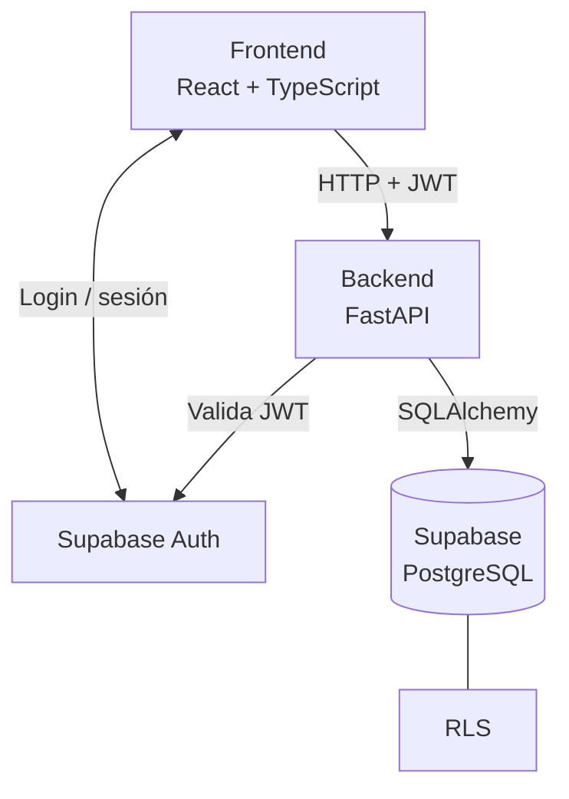

# ¿Por qué Supabase? — Decisión de plataforma de datos de PhishGuard

> **Estado:** ✅ Aceptada
> **Decisión:** usar **Supabase** (PostgreSQL gestionado) como plataforma de base de datos y **Supabase Auth** para la autenticación.

## Índice

- [Contexto](#contexto)
- [Qué necesitábamos](#qué-necesitábamos)
- [Alternativas consideradas](#alternativas-consideradas)
- [Motivos de la elección](#motivos-de-la-elección)
- [Por qué Supabase Auth](#por-qué-supabase-auth)
- [Qué no delegamos en Supabase](#qué-no-delegamos-en-supabase)
- [Inconvenientes asumidos y mitigaciones](#inconvenientes-asumidos-y-mitigaciones)
- [Conclusión](#conclusión)

---

## Contexto

PhishGuard es una plataforma web de detección de phishing desarrollada como proyecto académico. Su stack es **React + TypeScript** en el frontend y **FastAPI + SQLAlchemy** en el backend.

Necesitábamos una base de datos relacional para guardar usuarios, análisis, veredictos, reglas de detección y escenarios de laboratorio. El tiempo del proyecto debe invertirse en **construir la plataforma**, no en administrar servidores.

## Qué necesitábamos

| Requisito | Por qué |
|---|---|
| Base de datos relacional robusta | Modelo con muchas relaciones (análisis → veredictos → reglas) |
| SQL estándar | Consultas, restricciones, índices y migraciones con Alembic |
| Autenticación segura | Registro, login, sesiones y JWT sin desarrollarlo desde cero |
| Control de acceso por usuario | Cada usuario solo debe ver sus propios análisis |
| Herramienta visual | Revisar datos y depurar sin depender siempre de la terminal |
| Poco mantenimiento | Equipo pequeño y plazos académicos |
| Portabilidad | Poder migrar en el futuro sin rehacer el modelo |

## Alternativas consideradas

> Supabase **no sustituye** a PostgreSQL: lo usa como motor y añade servicios alrededor. La comparación real es entre *administrar PostgreSQL nosotros* o *usarlo gestionado*.

| Característica | PostgreSQL propio | Supabase |
|---|---|---|
| Motor SQL | PostgreSQL | PostgreSQL |
| Panel visual | Externo o a instalar | ✅ Integrado |
| Instalación | Manual | ✅ Gestionada |
| Mantenimiento | Nuestro | ✅ Gestionado en gran parte |
| Autenticación | A implementar | ✅ Supabase Auth |
| Row Level Security | Sí | Sí |
| Integración con FastAPI / SQLAlchemy | Sí | Sí |
| Copias de seguridad | Configuración propia | Según plan |
| Control del servidor | ✅ Total | Limitado |
| Coste de mantenimiento | Mayor | ✅ Menor |

PostgreSQL propio solo gana en **control de infraestructura**, algo que PhishGuard no necesita en esta fase.

## Motivos de la elección

### 1. Es PostgreSQL de verdad
Seguimos trabajando con SQL convencional, relaciones, índices, restricciones, vistas y funciones. No adoptamos una base de datos limitada ni propietaria.

### 2. Elimina la administración de servidores
No hay que instalar, configurar, actualizar ni vigilar una máquina dedicada a PostgreSQL.

### 3. Panel visual para desarrollar y depurar
- **Table Editor:** ver, insertar y modificar registros como en una hoja de cálculo; comprobar relaciones y qué usuario hizo cada análisis.
- **SQL Editor:** ejecutar consultas desde el navegador para verificar que el backend guarda bien los datos:
  ```sql
  SELECT *
  FROM analyses
  ORDER BY created_at DESC;
  ```

### 4. Autenticación incluida
Supabase Auth resuelve registro, login, logout, recuperación de contraseña, sesiones y tokens JWT.

### 5. Seguridad a nivel de fila (RLS)
Permite definir políticas en la propia base de datos; por ejemplo, que un usuario solo acceda a los análisis cuyo `user_id` coincide con su identidad.

### 6. Encaja con nuestro stack
Compatible con FastAPI, SQLAlchemy y Alembic sin cambiar la arquitectura prevista.

### 7. Sin dependencia irreversible
Los datos residen en PostgreSQL estándar. Si en el futuro hiciera falta, se puede migrar a otro servidor PostgreSQL con `pg_dump`.

## Por qué Supabase Auth

| Opción | Valoración |
|---|---|
| **Supabase Auth** ✅ | Gestión de credenciales, sesiones, JWT y recuperación de contraseña ya resuelta y probada |
| Autenticación propia en FastAPI | Más código, más superficie de error y más riesgo de seguridad sin aportar valor al proyecto |

Delegar la identidad nos permite centrarnos en lo que diferencia a PhishGuard: **el motor de detección**. Además, no almacenamos contraseñas en nuestras tablas.

## Qué no delegamos en Supabase

Para no duplicar responsabilidades, Supabase se usa como **base de datos + identidad**, no como backend completo.



| Tecnología | Responsabilidad |
|---|---|
| React | Interfaz |
| Supabase Auth | Identidad y sesiones |
| **FastAPI** | **Permisos, lógica de negocio y motor de detección** |
| SQLAlchemy | Acceso a datos |
| PostgreSQL (Supabase) | Almacenamiento |
| RLS | Capa adicional de control de acceso |

> [!WARNING]
> Si FastAPI se conecta con un rol administrativo, puede saltarse RLS. Por eso **FastAPI siempre comprueba la propiedad de los registros**; RLS es defensa adicional, no la única. Las claves secretas de Supabase solo existen en el servidor.

## Inconvenientes asumidos y mitigaciones

| Inconveniente | Mitigación |
|---|---|
| Requiere conexión a Internet | Aceptable: PhishGuard es una aplicación web |
| Límites del plan gratuito | Suficientes para el volumen de un proyecto académico |
| Pausa por inactividad (plan gratuito) | Reactivar el proyecto antes de demos y entregas |
| Sin backups diarios automáticos (plan gratuito) | Exportaciones periódicas con `pg_dump` o Supabase CLI |
| Menor control de infraestructura | No es necesario en esta fase |
| Dependencia del proveedor | Datos en PostgreSQL estándar → migrables |
| RLS mal configurado puede exponer datos | Revisión de políticas + validación de propiedad en FastAPI |

## Conclusión

Supabase nos da **PostgreSQL completo, autenticación, RLS y un panel visual** sin coste de administración, y es compatible con FastAPI y SQLAlchemy. Asumimos un menor control de la infraestructura a cambio de dedicar el tiempo del proyecto a la funcionalidad de PhishGuard, manteniendo la posibilidad de migrar a otro PostgreSQL si fuera necesario.
