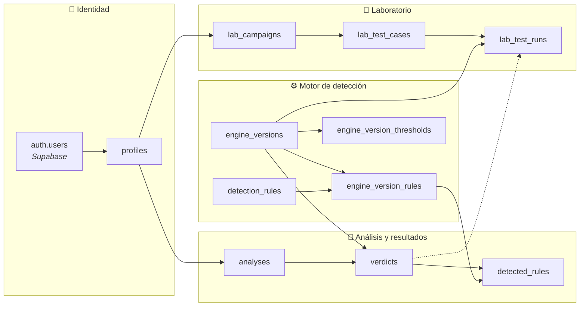

# Modelo Entidad-Relación — PhishGuard

> **Fase 3** · Modelo entidad-relación definitivo
> **Stack:** FastAPI · SQLAlchemy · Alembic · Supabase (PostgreSQL + Auth)

## Índice

- [1. Objetivo del modelo](#1-objetivo-del-modelo)
- [2. Principios de diseño](#2-principios-de-diseño)
- [3. Visión general de las tablas](#3-visión-general-de-las-tablas)
- [4. Tablas y por qué existen](#4-tablas-y-por-qué-existen)
  - [Identidad](#a-identidad)
  - [Análisis y resultados](#b-análisis-y-resultados)
  - [Motor de detección](#c-motor-de-detección)
  - [Laboratorio](#d-laboratorio)
- [5. Relaciones y cardinalidades](#5-relaciones-y-cardinalidades)
- [6. Restricciones e índices](#7-restricciones-e-índices)
- [7. Diagrama entidad-relación](#6-diagrama-entidad-relación)

---

## 1. Objetivo del modelo

Definir una estructura de datos que pueda convertirse **directamente en SQL** y después en **modelos SQLAlchemy**, sin tener que rediseñarla cuando la aplicación crezca.

El modelo debe permitir:

- Guardar qué analiza cada usuario y qué resultado obtuvo.
- Explicar **por qué** un contenido se clasificó como phishing (qué reglas se activaron).
- **Reproducir resultados históricos** aunque el motor cambie.
- Medir la precisión del motor mediante un laboratorio de pruebas.
- Proteger la privacidad del contenido analizado.

## 2. Principios de diseño

1. **Un análisis puede tener varios veredictos**, pero cada veredicto pertenece a un único análisis.
2. **Las reglas detectadas pertenecen a un veredicto concreto**, no directamente al análisis.
3. **Las versiones del motor conservan su configuración histórica**, para poder reproducir resultados anteriores.

## 3. Visión general de las tablas

| Área | Tabla | Responsabilidad | Prioridad |
|---|---|---|---|
| Identidad | `profiles` | Perfiles de usuario | Esencial |
| Análisis | `analyses` | Entradas analizadas | Esencial |
| Análisis | `verdicts` | Resultados generados | Esencial |
| Análisis | `detected_rules` | Reglas activadas en cada resultado | Esencial |
| Motor | `detection_rules` | Catálogo de reglas | Esencial |
| Motor | `engine_versions` | Versiones del motor | Esencial |
| Motor | `engine_version_rules` | Configuración de reglas por versión | Esencial |
| Motor | `engine_version_thresholds` | Umbrales de riesgo por versión | Esencial |
| Laboratorio | `lab_campaigns` | Campañas de prueba | Laboratorio |
| Laboratorio | `lab_test_cases` | Casos de prueba | Laboratorio |
| Laboratorio | `lab_test_runs` | Ejecuciones de pruebas | Laboratorio |

**11 tablas propias** + `auth.users`, gestionada por Supabase.

### Mapa de áreas

---

## 4. Tablas y por qué existen

### A. Identidad

#### `auth.users` *(gestionada por Supabase)*

No la creamos nosotros. Supabase Auth guarda en ella el email, las credenciales y las sesiones.

#### `profiles`

> **¿Por qué existe?** `auth.users` solo sabe *quién se ha autenticado*. PhishGuard necesita además saber *qué puede hacer* ese usuario (rol) y *si está activo*. No podemos (ni debemos) añadir columnas a la tabla interna de Supabase, así que creamos una tabla propia vinculada 1:1.

| Campo | Tipo | Descripción |
|---|---|---|
| `id` | `UUID` | PK y FK → `auth.users.id` |
| `name` | `VARCHAR(100)` | Nombre visible |
| `role` | `VARCHAR` | `USER` / `ADMIN` |
| `status` | `VARCHAR` | `ACTIVE` / `DISABLED` |
| `created_at` | `TIMESTAMPTZ` | Creación |
| `updated_at` | `TIMESTAMPTZ` | Última modificación |

- Usa el **mismo UUID** que `auth.users`: no hace falta un identificador adicional.
- **No guarda contraseñas** ni duplica el email: la identidad la gestiona Supabase.
- `status` permite **desactivar** a un usuario sin borrar su historial.

---

### B. Análisis y resultados

#### `analyses`

> **¿Por qué existe?** Representa **lo que el usuario envió a analizar**: un mensaje, una URL o unas cabeceras de correo. Es la petición, no el resultado. Separarla de `verdicts` permite reanalizar la misma entrada con otra versión del motor sin duplicar el contenido.

| Campo | Tipo | Descripción |
|---|---|---|
| `id` | `UUID` | PK |
| `user_id` | `UUID` | FK → `profiles.id` (propietario) |
| `analysis_type` | `VARCHAR` | `MESSAGE` / `URL` / `HEADERS` |
| `message_channel` | `VARCHAR` | `EMAIL` / `SMS` / `OTHER` · nullable |
| `input_content` | `TEXT` | Contenido original · nullable |
| `input_metadata` | `JSONB` | Metadatos adicionales |
| `status` | `VARCHAR` | `PENDING` / `PROCESSING` / `COMPLETED` / `FAILED` |
| `created_at` | `TIMESTAMPTZ` | Creación |
| `completed_at` | `TIMESTAMPTZ` | Finalización |
| `deleted_at` | `TIMESTAMPTZ` | Borrado lógico · nullable |

- `message_channel` distingue email de SMS **sin multiplicar los tipos de análisis**.
- `input_content` es **opcional**: se puede conservar el resultado sin guardar indefinidamente un mensaje que puede contener datos personales.
- `input_metadata` en `JSONB` admite datos que varían según el tipo (remitente, dominio, cabeceras…) sin añadir columnas.
- `status` refleja el ciclo de vida del procesamiento y permite detectar análisis fallidos.

#### `verdicts`

> **¿Por qué existe?** Es **el resultado** que el motor produce para un análisis. Está separado de `analyses` porque un mismo análisis puede procesarse varias veces (por ejemplo, tras actualizar el motor). Si guardáramos el resultado dentro de `analyses`, cada reanálisis **sobrescribiría** el anterior y perderíamos el historial.

| Campo | Tipo | Descripción |
|---|---|---|
| `id` | `UUID` | PK |
| `analysis_id` | `UUID` | FK → `analyses.id` |
| `engine_version_id` | `UUID` | FK → `engine_versions.id` |
| `execution_number` | `INTEGER` | Nº de ejecución dentro del análisis |
| `score` | `INTEGER` | Puntuación 0–100 |
| `classification` | `VARCHAR` | `LOW` / `MEDIUM` / `HIGH` |
| `verdict` | `TEXT` | Veredicto textual |
| `summary` | `TEXT` | Resumen |
| `recommendations` | `JSONB` | Recomendaciones al usuario |
| `duration_ms` | `INTEGER` | Tiempo de procesamiento |
| `rules_evaluated` | `INTEGER` | Nº de reglas evaluadas |
| `created_at` | `TIMESTAMPTZ` | Generación |

- **Ejemplo:** un correo obtiene 75/100 con la v1.0.0; tras actualizar a la v1.1.0 obtiene 90/100. Ambos veredictos se conservan y se sabe qué versión generó cada uno.
- `execution_number` ordena las ejecuciones de un mismo análisis (1, 2, 3…).
- `engine_version_id` deja **trazabilidad**: todo resultado se puede atribuir a una versión concreta del motor.
- `duration_ms` y `rules_evaluated` sirven para medir el rendimiento del motor.
- Los campos coinciden con la interfaz `AnalysisResult` del frontend (puntuación, señales, recomendaciones, duración y versión).

#### `detected_rules`

> **¿Por qué existe?** Una puntuación por sí sola no explica nada. Esta tabla guarda **qué reglas se activaron, cuánto sumó cada una y por qué**, que es lo que permite mostrar al usuario una explicación y auditar el comportamiento del motor.

| Campo | Tipo | Descripción |
|---|---|---|
| `id` | `UUID` | PK |
| `verdict_id` | `UUID` | FK → `verdicts.id` |
| `engine_version_rule_id` | `UUID` | FK → `engine_version_rules.id` |
| `applied_score` | `INTEGER` | Puntuación aplicada |
| `explanation` | `TEXT` | Explicación para el usuario |
| `evidence` | `TEXT` | Fragmento o dato que activó la regla |
| `details` | `JSONB` | Información técnica adicional |
| `created_at` | `TIMESTAMPTZ` | Detección |

- Cuelga de **`verdicts`, no de `analyses`**: así sabemos qué reglas se activaron en *cada ejecución*, no una mezcla de todas.
- Referencia **`engine_version_rule_id` en vez de `rule_id`**: no solo indica qué regla se activó, sino **con qué configuración** (puntuación y estado en esa versión).
- `applied_score` y `explanation` son una **fotografía histórica**: si mañana cambia la puntuación de una regla, los resultados antiguos no se alteran.

---

### C. Motor de detección

#### `detection_rules`

> **¿Por qué existe?** Es el **catálogo** de reglas que el motor sabe aplicar: *qué es* cada regla, independientemente de la versión. Separar la definición de su configuración evita duplicar nombres y descripciones en cada versión.

| Campo | Tipo | Descripción |
|---|---|---|
| `id` | `UUID` | PK |
| `code` | `VARCHAR` | Código único |
| `name` | `VARCHAR` | Nombre |
| `description` | `TEXT` | Descripción |
| `category` | `VARCHAR` | Categoría |
| `created_at` | `TIMESTAMPTZ` | Creación |
| `updated_at` | `TIMESTAMPTZ` | Actualización |

Ejemplos de `code`: `SUSPICIOUS_DOMAIN`, `URGENCY_LANGUAGE`, `CREDENTIAL_REQUEST`, `SPOOFED_SENDER`, `SPF_FAILURE`, `DKIM_FAILURE`, `DMARC_FAILURE`.

- `code` es el identificador estable que usa el código del motor.
- No contiene puntuaciones: estas dependen de la versión y van en `engine_version_rules`.

#### `engine_versions`

> **¿Por qué existe?** El motor evolucionará. Registrar cada versión permite saber **qué lógica produjo cada resultado** y comparar versiones entre sí.

| Campo | Tipo | Descripción |
|---|---|---|
| `id` | `UUID` | PK |
| `version` | `VARCHAR` | Versión única (`1.0.0`, `1.1.0`…) |
| `description` | `TEXT` | Cambios introducidos |
| `status` | `VARCHAR` | Estado de la versión |
| `created_at` | `TIMESTAMPTZ` | Creación |
| `published_at` | `TIMESTAMPTZ` | Publicación |

- Una versión publicada **no se modifica**: los cambios se hacen creando una versión nueva.

#### `engine_version_rules`

> **¿Por qué existe?** Una misma regla puede existir en varias versiones con **distinta puntuación** o estar **activada en unas y desactivada en otras**. Esta tabla resuelve la relación N:M entre versiones y reglas y guarda la configuración de cada combinación.

| Campo | Tipo | Descripción |
|---|---|---|
| `id` | `UUID` | PK |
| `engine_version_id` | `UUID` | FK → `engine_versions.id` |
| `rule_id` | `UUID` | FK → `detection_rules.id` |
| `configured_score` | `INTEGER` | Puntuación en esa versión |
| `is_enabled` | `BOOLEAN` | Activa en esa versión |

- **Ejemplo:** `URGENCY_LANGUAGE` vale 15 puntos en la v1.0.0 y 20 en la v1.1.0. Son dos filas distintas.
- Permite **reproducir** exactamente la configuración de cualquier versión anterior.

#### `engine_version_thresholds`

> **¿Por qué existe?** La clasificación `LOW` / `MEDIUM` / `HIGH` depende de unos límites de puntuación. Si los fijáramos en el código o en el SQL, cambiarlos alteraría la interpretación de resultados antiguos. Guardarlos **por versión** garantiza que un 50 se interprete siempre según los umbrales vigentes cuando se generó.

| Campo | Tipo | Descripción |
|---|---|---|
| `id` | `UUID` | PK |
| `engine_version_id` | `UUID` | FK → `engine_versions.id` |
| `classification` | `VARCHAR` | `LOW` / `MEDIUM` / `HIGH` |
| `min_score` | `INTEGER` | Límite inferior |
| `max_score` | `INTEGER` | Límite superior |

Ejemplo de configuración:

| Clasificación | Mínimo | Máximo |
|---|---:|---:|
| LOW | 0 | 29 |
| MEDIUM | 30 | 59 |
| HIGH | 60 | 100 |

---

### D. Laboratorio

El laboratorio sirve para **comprobar objetivamente si el motor detecta bien**: se preparan escenarios con un resultado esperado y se compara con lo que el motor devuelve.

#### `lab_campaigns`

> **¿Por qué existe?** Agrupa casos de prueba bajo un mismo escenario (por ejemplo, *suplantación bancaria* o *SMS de paquetería*). Permite organizar las pruebas y evaluar el motor por tipo de ataque.

| Campo | Tipo | Descripción |
|---|---|---|
| `id` | `UUID` | PK |
| `name` | `VARCHAR` | Nombre |
| `description` | `TEXT` | Descripción |
| `scenario_type` | `VARCHAR` | Tipo de escenario |
| `status` | `VARCHAR` | Estado |
| `created_by` | `UUID` | FK → `profiles.id` |
| `created_at` | `TIMESTAMPTZ` | Creación |
| `completed_at` | `TIMESTAMPTZ` | Finalización |

#### `lab_test_cases`

> **¿Por qué existe?** Define **un caso de prueba concreto**: el contenido a analizar y el resultado que *debería* obtener el motor. Es la referencia contra la que se mide.

| Campo | Tipo | Descripción |
|---|---|---|
| `id` | `UUID` | PK |
| `campaign_id` | `UUID` | FK → `lab_campaigns.id` |
| `name` | `VARCHAR` | Nombre |
| `description` | `TEXT` | Descripción |
| `input_type` | `VARCHAR` | Tipo de entrada |
| `test_content` | `TEXT` | Contenido de prueba |
| `expected_classification` | `VARCHAR` | Clasificación esperada |
| `expected_min_score` | `INTEGER` | Puntuación mínima esperada |
| `expected_max_score` | `INTEGER` | Puntuación máxima esperada |
| `created_at` | `TIMESTAMPTZ` | Creación |

#### `lab_test_runs`

> **¿Por qué existe?** **Definir** un caso no es lo mismo que **ejecutarlo**. Un caso se ejecuta muchas veces, con distintas versiones del motor. Esta tabla registra cada ejecución y si superó la prueba, lo que permite comparar la precisión entre versiones.

| Campo | Tipo | Descripción |
|---|---|---|
| `id` | `UUID` | PK |
| `test_case_id` | `UUID` | FK → `lab_test_cases.id` |
| `engine_version_id` | `UUID` | FK → `engine_versions.id` |
| `analysis_id` | `UUID` | FK → `analyses.id` · nullable |
| `verdict_id` | `UUID` | FK → `verdicts.id` · nullable |
| `status` | `VARCHAR` | Estado de la ejecución |
| `passed` | `BOOLEAN` | Si cumplió lo esperado |
| `executed_at` | `TIMESTAMPTZ` | Ejecución |

- Reutiliza `analyses` y `verdicts` en lugar de duplicar puntuaciones y reglas: el resultado de una prueba es un veredicto normal.
- `analysis_id` y `verdict_id` son **nullables** porque una ejecución puede fallar antes de producir resultado.

---

## 5. Relaciones y cardinalidades

| Relación | Cardinalidad | Significado |
|---|---|---|
| `auth.users` → `profiles` | 1:1 | Cada identidad tiene un perfil |
| `profiles` → `analyses` | 1:N | Un usuario realiza muchos análisis |
| `analyses` → `verdicts` | 1:N | Un análisis puede procesarse varias veces |
| `engine_versions` → `verdicts` | 1:N | Una versión genera muchos veredictos |
| `verdicts` → `detected_rules` | 1:N | Un veredicto activa varias reglas |
| `engine_version_rules` → `detected_rules` | 1:N | Una regla configurada se activa en muchos veredictos |
| `detection_rules` → `engine_version_rules` | 1:N | Una regla se configura en muchas versiones |
| `engine_versions` → `engine_version_rules` | 1:N | Una versión configura muchas reglas |
| `engine_versions` → `engine_version_thresholds` | 1:N | Una versión define sus umbrales |
| `profiles` → `lab_campaigns` | 1:N | Un usuario crea campañas |
| `lab_campaigns` → `lab_test_cases` | 1:N | Una campaña contiene varios casos |
| `lab_test_cases` → `lab_test_runs` | 1:N | Un caso se ejecuta muchas veces |
| `engine_versions` → `lab_test_runs` | 1:N | Una versión participa en muchas ejecuciones |
| `analyses` → `lab_test_runs` | 1:N (opcional) | Una ejecución puede referenciar su análisis |
| `verdicts` → `lab_test_runs` | 1:N (opcional) | Una ejecución puede referenciar su veredicto |

> La relación entre `detection_rules` y `engine_versions` es **N:M**, resuelta mediante `engine_version_rules`.

---

## 6. Restricciones e índices

### Restricciones

| Tabla | Restricción | Motivo |
|---|---|---|
| `profiles` | PK vinculada a `auth.users` | Un perfil por identidad |
| `analyses` | `user_id` obligatorio | Todo análisis tiene propietario |
| `analyses` | `analysis_type` limitado a valores permitidos | Evitar tipos inválidos |
| `verdicts` | `score` entre 0 y 100 | Escala de riesgo coherente |
| `verdicts` | `execution_number > 0` | Numeración válida |
| `verdicts` | `UNIQUE (analysis_id, execution_number)` | Sin ejecuciones duplicadas |
| `detection_rules` | `code` único | Identificador estable de regla |
| `engine_versions` | `version` única | Sin versiones repetidas |
| `engine_version_rules` | `UNIQUE (engine_version_id, rule_id)` | Una configuración por regla y versión |
| `engine_version_thresholds` | `UNIQUE (engine_version_id, classification)` | Un umbral por clasificación y versión |
| `engine_version_thresholds` | Límites entre 0 y 100 | Coherencia con `score` |
| `detected_rules` | `applied_score` validado | Puntuaciones válidas |
| `lab_test_cases` | `campaign_id` obligatorio | Todo caso pertenece a una campaña |

### Reglas de eliminación

| Regla | Aplicación | Motivo |
|---|---|---|
| `ON DELETE CASCADE` | Veredictos y reglas detectadas al borrar un análisis | No dejar resultados huérfanos |
| `ON DELETE RESTRICT` | Versiones y reglas con resultados históricos | Proteger la trazabilidad |

### Índices

- `analyses.user_id` — historial del usuario.
- `analyses.created_at` — ordenación cronológica.
- `verdicts.analysis_id` — resultados de un análisis.
- Claves foráneas de uso frecuente.

> [!WARNING]
> **Coherencia en `lab_test_runs`:** `analysis_id` y `verdict_id` deben corresponder entre sí. Se garantizará con una restricción relacional o validación transaccional en el backend, para que una ejecución nunca apunte a un veredicto de otro análisis.

## 7. Decisiones de diseño

| Decisión | Motivo |
|---|---|
| `profiles` separada de `auth.users` | No modificar tablas internas de Supabase; añadir rol y estado |
| `analyses` separada de `verdicts` | Reanalizar sin perder resultados anteriores |
| `detected_rules` cuelga de `verdicts` | Saber qué reglas se activaron en cada ejecución |
| `detected_rules` → `engine_version_rule_id` | Conocer la configuración exacta usada |
| `applied_score` y `explanation` guardados | Fotografía histórica inmutable |
| Catálogo (`detection_rules`) separado de configuración (`engine_version_rules`) | Evitar duplicar definiciones; versionar puntuaciones |
| Umbrales en `engine_version_thresholds` | Configurables y versionados, no fijos en código |
| Versiones publicadas inmutables | Reproducibilidad de resultados |
| `input_content` opcional | Privacidad del contenido analizado |
| `message_channel` en lugar de más tipos | No multiplicar `analysis_type` |
| `lab_test_runs` separado de `lab_test_cases` | Comparar ejecuciones entre versiones |
| Laboratorio reutiliza `analyses` y `verdicts` | No duplicar la lógica de resultados |

## 8. Diagrama entidad-relación de PhishGuard (modelo lógico)

