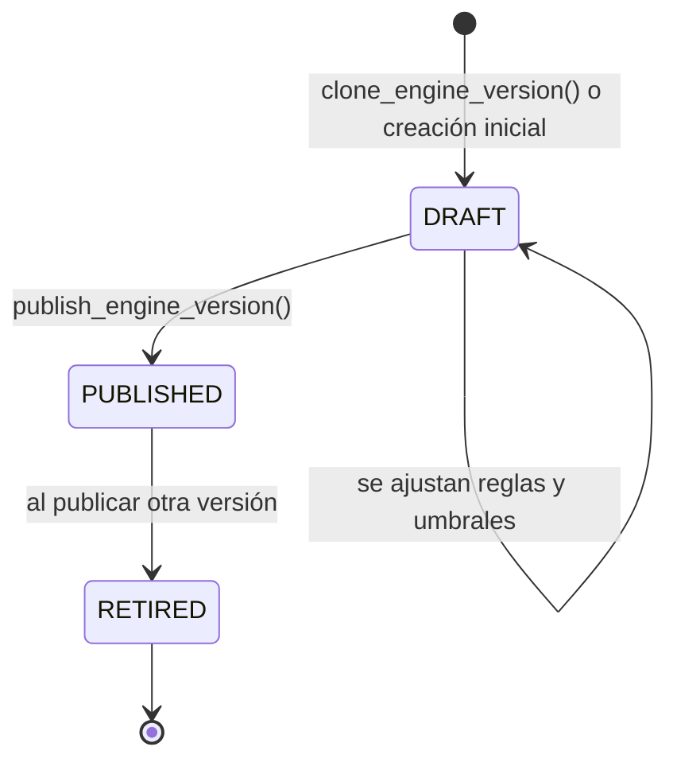

# ⚙️ Triggers y procedimientos almacenados

> Qué lógica vive **dentro de la base de datos**, por qué está ahí y no en el backend, y cómo se usa.
>
> **Triggers:** 5 (3 existentes + 2 previstos) · **Funciones:** 3 · **Procedimientos almacenados:** 3 (previstos)
> **Scripts:** `esquemas/001_schema.sql` (existentes) · `esquemas/004_procedimientos.sql` (previstos)

## Índice

- [1. Conceptos](#1-conceptos)
- [2. Criterio: qué va en la base de datos y qué en Python](#2-criterio-qué-va-en-la-base-de-datos-y-qué-en-python)
- [3. Triggers](#3-triggers)
- [4. Procedimientos almacenados](#4-procedimientos-almacenados)
- [5. Versiones del motor: ciclo de vida](#5-versiones-del-motor-ciclo-de-vida)
- [6. Retención de datos y privacidad](#6-retención-de-datos-y-privacidad)
- [7. Seguridad](#7-seguridad)
- [8. Resumen](#8-resumen)

---

## 1. Conceptos

| Concepto | Qué es | Cómo se ejecuta | Ejemplo |
|---|---|---|---|
| **Trigger** | Una acción automática asociada a una tabla | Solo, cuando ocurre un evento (`INSERT`, `UPDATE`, `DELETE`) | "Cuando se registre un usuario, crea su perfil" |
| **Función** | Código guardado en la base de datos que devuelve un resultado | La llama un trigger o una consulta | `set_updated_at()` |
| **Procedimiento almacenado** | Código guardado en la base de datos que realiza una operación completa | Alguien lo llama con `CALL` | `CALL publish_engine_version('1.0.0')` |

> **Diferencia clave:** el trigger se dispara **solo**; el procedimiento se ejecuta **cuando alguien lo llama**.

---

## 2. Criterio: qué va en la base de datos y qué en Python

PhishGuard mantiene la **lógica de negocio en el backend** (Python), porque es más fácil de programar, probar y mantener. En la base de datos solo va lo que cumple alguna de estas condiciones:

| Condición | Por qué en la base de datos |
|---|---|
| **Debe cumplirse siempre**, venga el cambio de donde venga | Un trigger protege los datos aunque se modifiquen desde el SQL Editor o desde otro programa, no solo desde el backend |
| **Son varios pasos que deben ocurrir todos o ninguno** | Un procedimiento se ejecuta en una sola transacción: si un paso falla, no se aplica nada |
| **Es una tarea de mantenimiento de los propios datos** | No depende de que alguien se acuerde: se programa y se ejecuta sola |

| ✅ En la base de datos | ❌ En Python |
|---|---|
| Crear el perfil al registrarse | Analizar mensajes |
| Actualizar fechas de modificación | Aplicar las reglas del motor |
| Proteger las versiones publicadas | Llamar a la IA |
| Publicar y clonar versiones del motor | Comprobar permisos de usuario |
| Borrar contenido antiguo (privacidad) | Generar recomendaciones |

---

## 3. Triggers

### 3.1 `on_auth_user_created` · crea el perfil al registrarse

| | |
|---|---|
| **Tabla** | `auth.users` (de Supabase Auth) |
| **Cuándo** | Después de cada `INSERT` (cuando alguien se registra) |
| **Función** | `handle_new_user()` |
| **Estado** | ✅ Existente (`001_schema.sql`) |

**Qué hace:** inserta en `profiles` una fila con el mismo `id` que el usuario, rol `USER` y estado `ACTIVE`. El nombre se toma de los datos del registro; si no hay, se usa la parte del email anterior a la @.

```
María se registra → Supabase Auth inserta en auth.users
                  → el trigger inserta en profiles: (id, "maria", USER, ACTIVE)
```

**Por qué un trigger:** `auth.users` pertenece a Supabase y `profiles` es nuestra. Sin el trigger, el backend tendría que crear el perfil en cada registro, y un fallo dejaría usuarios sin perfil ni rol. Con el trigger es **imposible** que un usuario exista sin su perfil.

### 3.2 `trg_profiles_updated_at` · fecha de modificación del perfil

| | |
|---|---|
| **Tabla** | `profiles` |
| **Cuándo** | Antes de cada `UPDATE` |
| **Función** | `set_updated_at()` |
| **Estado** | ✅ Existente (`001_schema.sql`) |

**Qué hace:** pone `updated_at = now()` justo antes de guardar cualquier cambio en un perfil.

**Por qué un trigger:** la fecha queda siempre correcta, aunque el cambio se haga desde el panel de Supabase o un desarrollador olvide actualizarla en el código.

### 3.3 `trg_detection_rules_updated_at` · fecha de modificación de las reglas

| | |
|---|---|
| **Tabla** | `detection_rules` |
| **Cuándo** | Antes de cada `UPDATE` |
| **Función** | `set_updated_at()` (la misma que 3.2) |
| **Estado** | ✅ Existente (`001_schema.sql`) |

**Qué hace:** igual que el anterior, para el catálogo de reglas. La función se escribe una vez y se reutiliza.

### 3.4 `trg_evr_protect_published` y `trg_evt_protect_published` · protegen las versiones publicadas

| | |
|---|---|
| **Tablas** | `engine_version_rules` y `engine_version_thresholds` |
| **Cuándo** | Antes de cada `INSERT`, `UPDATE` o `DELETE` |
| **Función** | `protect_published_version()` |
| **Estado** | 🆕 Previsto (`004_procedimientos.sql`) |

**Qué hace:** si la versión del motor afectada **no está en `DRAFT`** (borrador), cancela la operación con un error.

```
Alguien intenta cambiar los puntos de URGENCY_LANGUAGE en la 1.0.0 (ya publicada)
   → el trigger lo bloquea: "La versión 1.0.0 está publicada y no se puede modificar.
                             Clónala con clone_engine_version()."
```

**Por qué un trigger:** una versión publicada ha generado resultados reales. Si se cambiara su configuración, ya no se podría saber con qué reglas y puntos se calcularon los análisis antiguos. Hasta ahora esta regla solo la vigilaba el backend; con el trigger, **la garantiza la base de datos**, sin excepciones.

---

## 4. Procedimientos almacenados

Todos están **previstos** en `004_procedimientos.sql`.

### 4.1 `publish_engine_version(version)` · publicar una versión del motor

```sql
CALL publish_engine_version('1.0.0');
```

**Qué hace, en una sola transacción:**

1. Comprueba que la versión existe y está en `DRAFT`.
2. Comprueba que tiene **al menos una regla activa**.
3. Comprueba que los **umbrales son correctos**: existen `LOW`, `MEDIUM` y `HIGH`, empiezan en 0, terminan en 100 y no tienen huecos ni solapamientos.
4. Pasa la versión publicada actual (si hay) a `RETIRED`.
5. Pasa la nueva versión a `PUBLISHED` y guarda la fecha en `published_at`.

Si cualquier comprobación falla, **no cambia nada** y devuelve un error que explica el motivo.

**Por qué en la base de datos:** son varios cambios que deben ocurrir **todos o ninguno**. Nunca puede quedar el sistema con dos versiones activas, o con ninguna, por un fallo a mitad de camino.

**Quién lo usa:** un administrador, desde el panel de administración (a través del backend) o desde el SQL Editor de Supabase.

### 4.2 `clone_engine_version(origen, destino, descripción)` · crear una versión a partir de otra

```sql
CALL clone_engine_version('1.0.0', '1.1.0', 'Añade la regla de IA AI_SOCIAL_ENGINEERING');
```

**Qué hace, en una sola transacción:**

1. Comprueba que la versión de origen existe y que la de destino **no** existe.
2. Crea la versión de destino en `DRAFT`.
3. Copia todas las reglas con sus puntos y su estado (`engine_version_rules`).
4. Copia los umbrales (`engine_version_thresholds`).

Después, sobre la copia en borrador, se hacen los cambios (activar la IA, ajustar puntos…) y se publica con `publish_engine_version`.

**Por qué en la base de datos:** evita insertar a mano decenas de filas y garantiza que la copia es exacta.

### 4.3 `purge_analysis_content(días)` · borrar el contenido antiguo

```sql
CALL purge_analysis_content(30);
```

**Qué hace:** borra el texto original (`input_content = NULL`) de los análisis con más de `días` de antigüedad y **conserva todo lo demás**. Informa de cuántos análisis ha limpiado.

| Se borra | Se conserva |
|---|---|
| `analyses.input_content` (el mensaje completo) | Puntuación, clasificación y veredicto |
| | Reglas activadas, explicación y evidencia |
| | Fecha, tipo y canal del análisis |

**Por qué en la base de datos:** es una tarea de mantenimiento de los propios datos que debe ejecutarse sola, sin depender de nadie. Se programa con `pg_cron`, el planificador de tareas de PostgreSQL que incluye Supabase (ver [sección 6](#6-retención-de-datos-y-privacidad)).

**Parámetro:** el número de días es configurable. El valor por defecto es **30**.

---

## 5. Versiones del motor: ciclo de vida

> **Importante:** "versión" se refiere siempre a la **versión del motor de detección** (tabla `engine_versions`: qué reglas usa, cuántos puntos vale cada una y los umbrales), **no** a la versión de la estructura de la base de datos (scripts `001`, `002`, `003`…).



| Estado | Se puede modificar | Se usa para analizar | Ejemplo |
|---|:-:|:-:|---|
| `DRAFT` | ✅ | ❌ | La 1.1.0 mientras se integra la IA |
| `PUBLISHED` | ❌ (trigger 3.4) | ✅ (solo una a la vez) | La versión actual |
| `RETIRED` | ❌ (trigger 3.4) | ❌ | La 1.0.0 tras publicar la 1.1.0; sus resultados siguen consultables |

**Ejemplo completo:**

```sql
-- 1. Publicar la primera versión cuando el motor esté programado
CALL publish_engine_version('1.0.0');

-- 2. Más adelante, preparar la versión con IA
CALL clone_engine_version('1.0.0', '1.1.0', 'Añade la regla de IA');
-- ... activar AI_SOCIAL_ENGINEERING en la 1.1.0 y probarla en el laboratorio ...

-- 3. Publicarla: la 1.0.0 pasa automáticamente a RETIRED
CALL publish_engine_version('1.1.0');
```

---

## 6. Retención de datos y privacidad

### Por qué borrar el contenido

Los mensajes que analizan los usuarios contienen **datos personales**: nombres, teléfonos, direcciones y, a veces, datos bancarios, tanto del usuario como de terceros. El **RGPD** exige:

- **Minimización:** guardar solo los datos necesarios.
- **Limitación del plazo de conservación:** no guardarlos más tiempo del necesario.

Pasado un tiempo, PhishGuard ya no necesita el mensaje completo: lo útil es el **resultado**. Borrar el contenido reduce los datos expuestos si la base de datos se viera comprometida, sin perder el historial ni las estadísticas.

### Consecuencias

| Ventaja | Inconveniente |
|---|---|
| Muchos menos datos personales almacenados | Pasado el plazo, el usuario no puede volver a leer el mensaje completo |
| El historial y las estadísticas se mantienen | No se puede reanalizar ese mensaje con una versión nueva del motor |
| Cumplimiento automático, sin intervención manual | — |

El **laboratorio no se ve afectado**: usa sus propios mensajes de prueba (`lab_test_cases.test_content`), que no son datos de usuarios.

### Ejecución automática con `pg_cron`

1. En Supabase, activar la extensión **`pg_cron`** (Database → Extensions, o Integrations → Cron).
2. Programar el procedimiento para que se ejecute cada noche a las 03:00:

```sql
select cron.schedule(
  'purgar-contenido-analisis',
  '0 3 * * *',
  $$ call public.purge_analysis_content(30) $$
);
```

---

## 7. Seguridad

| Medida | Motivo |
|---|---|
| Los procedimientos **no se pueden ejecutar** con las claves públicas de Supabase (`anon`, `authenticated`) | Solo el backend y los administradores de la base de datos pueden publicar versiones o borrar contenido |
| Las funciones usan `set search_path = ''` | Evita que alguien suplante tablas o funciones con otras del mismo nombre |
| Todas las comprobaciones devuelven **errores explicativos** | Si algo no se cumple, se sabe exactamente por qué y no se aplica ningún cambio |
| `purge_analysis_content` rechaza valores menores de 1 día | Evita borrar por error el contenido de los análisis recientes |

---

## 8. Resumen

| Tipo | Nombre | Tabla / uso | Estado |
|---|---|---|---|
| Trigger | `on_auth_user_created` | `auth.users` → crea el perfil | ✅ |
| Trigger | `trg_profiles_updated_at` | `profiles` → fecha de modificación | ✅ |
| Trigger | `trg_detection_rules_updated_at` | `detection_rules` → fecha de modificación | ✅ |
| Trigger | `trg_evr_protect_published` | `engine_version_rules` → protege versiones publicadas | 🆕 |
| Trigger | `trg_evt_protect_published` | `engine_version_thresholds` → protege versiones publicadas | 🆕 |
| Función | `handle_new_user()` | Usada por `on_auth_user_created` | ✅ |
| Función | `set_updated_at()` | Usada por los triggers de `updated_at` | ✅ |
| Función | `protect_published_version()` | Usada por los triggers de protección | 🆕 |
| Procedimiento | `publish_engine_version(version)` | Publicar una versión del motor | 🆕 |
| Procedimiento | `clone_engine_version(origen, destino, descripción)` | Crear una versión a partir de otra | 🆕 |
| Procedimiento | `purge_analysis_content(días)` | Borrar el contenido antiguo (privacidad) | 🆕 |
